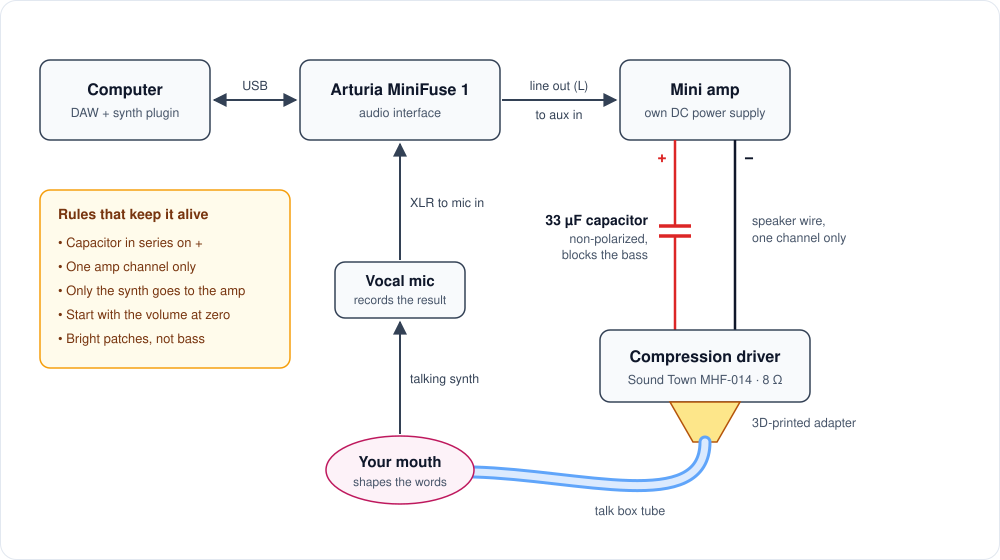
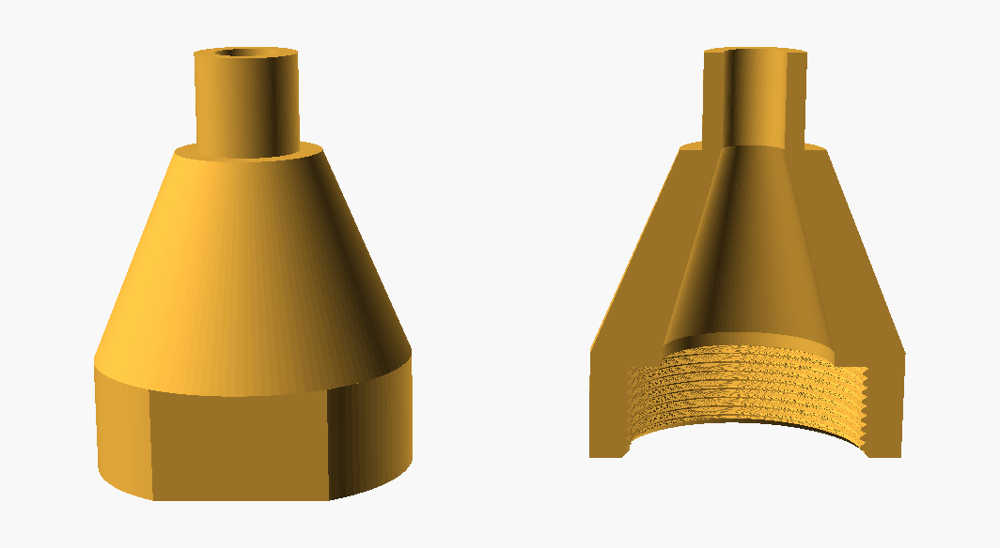

# DIY Talk Box

<!-- To show a photo: upload it to the images folder, then delete the comment markers around its line below. -->

A homemade talk box played from a computer. A PA compression driver sends a synth's sound up a tube into your mouth, you shape words silently, and a mic records the instrument "talking". It's built from a tweeter driver, one capacitor, a small desktop amp and a 3D-printed adapter instead of a commercial talk box pedal.

<!--  -->

## How it works

The amp drives a compression driver, but instead of a horn the driver's output goes up a tube into your mouth. Your mouth acts as a filter: as you mouth words, the synth takes on the shape of the vowels and consonants. A mic in front of your mouth picks up the result.



## Parts

| Part | Used in this build | Notes |
| --- | --- | --- |
| Compression driver | [Sound Town MHF-014](https://www.soundtown.com/products/mhf-014) | 1" PA tweeter driver: 8 Ω, 50 W RMS, 110 dB at 1 W/1 m, standard 1-3/8"-18 screw-on throat. Horn removed. |
| Capacitor | 33 µF, 100 V, non-polarized electrolytic | Must be non-polarized (marked NP or BP). Sold as tweeter crossover capacitors. |
| Amplifier | Small desktop speaker amp | Needs speaker terminals. Headphone and line outputs are too weak to drive the driver. |
| Audio interface | Arturia MiniFuse 1 | Line out feeds the amp; the mic input records the talk box. |
| Tube | Replacement tube for the MXR M222 talk box | The genuine Dunlop ECB303 is 6.5 ft with a 0.58" tube and 0.795" coupler. Clones vary, so measure yours. |
| Adapter | 3D printed, see [`adapter/`](adapter/) | Screws onto the driver and steps the 1" throat down to the tube. |
| Also | Speaker wire, solder, heat shrink, a vocal mic and stand | |

## Wiring

```
amp +  ────[ 33 µF NP ]────  driver +
amp −  ────────────────────  driver −
```

- The capacitor goes in series on the + lead. It's non-polarized, so either way round works, and driver polarity doesn't matter for a talk box.
- Wire one amp channel only, then pan the synth hard to that side (or send it in mono).
- Insulate the capacitor's solder joints. If + and − touch anywhere, many amps mute themselves.
- The amp needs its own DC adapter plugged in. Over USB alone it can light up and show up on the computer while the amplifier itself has no power.

<!--  -->

### Why the capacitor matters

The MHF-014 only works from about 2 kHz up (its resonance is 1.8 kHz). Bass makes its tiny diaphragm hit the end of its travel, which can destroy it in seconds; a stray kick drum or the pop of a cable being plugged in is enough. The capacitor and the driver's 8 Ω form a high-pass filter, cutoff = 1 / (2π × 8 Ω × C):

| Capacitor | Cutoff | |
| --- | --- | --- |
| 22 µF | about 900 Hz | most protection, thinner sound |
| **33 µF** | **about 600 Hz** | **used here** |
| 47 µF | about 420 Hz | fuller sound, less safety margin |

Never run the driver without it.

## The 3D-printed adapter



Three sections: a female 1-3/8"-18 thread that screws onto the driver, a 30 mm cone that narrows the 1" throat gradually (a sudden step into a small hole wastes output), and a spigot that the tube's coupler slides over.

| File | |
| --- | --- |
| [`talkbox_adapter.scad`](adapter/talkbox_adapter.scad) | Parametric source for [OpenSCAD](https://openscad.org) (free) |
| [`talkbox_adapter.stl`](adapter/talkbox_adapter.stl) | Ready to print, default sizes |
| [`thread_test_ring.stl`](adapter/thread_test_ring.stl) | 9 mm ring of just the thread, to check the fit first |

To fit it to your printer and tube:

1. Print `thread_test_ring.stl` and screw it onto the driver. If it binds, raise `thread_clear` in the .scad (try 0.6); if it wobbles, lower it (0.25).
2. Measure the inside of your tube's coupler. Set `stub_od` about 0.2 mm smaller, and `stub_bore` to the tube's bore.
3. Set `part = "adapter"`, render with F6 and export the STL. The F5 preview draws the threads badly; trust the F6 render.

| Print setting | Value | Why |
| --- | --- | --- |
| Orientation | Threaded end down | Clean threads, nothing to support inside the cone |
| Supports | None | The slicer flags the thread flanks and a small ledge inside; both print fine, and supports inside the bore can't be removed |
| Infill | 100% | It has to be airtight; sparse infill leaks and lets the walls buzz |
| Perimeters | 4–5 | Most of the sealing comes from the walls |
| Material | PETG or PLA | PLA is fine indoors but softens in a hot car |
| Brim | On | Tall part, small footprint |

Printed plastic isn't food safe, so the tube should be the only thing that touches your mouth. If the print leaks, brush a thin coat of epoxy inside the cone.

<!--  -->

## Playing it

1. Turn the amp all the way down before connecting anything.
2. In the DAW, route only the synth to the MiniFuse output that feeds the amp, and monitor on headphones. Anything else on that output (click, drums) goes up the tube and into the mic.
3. Play a sustained, bright note and bring the volume up slowly with the tube pointed away from your face.
4. Put the tube about 1/2" to 1" into your mouth, right next to the vocal mic, and mouth the words without using your voice.

Bright, buzzy patches (saws, squares, distorted guitar) work best. Low notes barely come through because the driver can't reproduce bass; that's normal for talk boxes, and why the dry synth usually gets blended back in when mixing.

**Look after your hearing.** Keep the level where you could talk over it, keep sessions short, and if your ears ring afterward it was too loud. Wash the tube between uses.

<!--  -->

## Troubleshooting

| Symptom | What to check |
| --- | --- |
| Amp light on, but no sound from anything | Plug in the amp's DC adapter (see Wiring). |
| A regular speaker on the amp is silent too | Make the amp the system output, raise that device's own volume, check the DAW's output routing, and pan the synth to the channel you wired. |
| A regular speaker works, the talk box doesn't | Briefly touch the + wire straight to the driver, skipping the capacitor, at very low volume. If that plays, redo the capacitor's solder joints. |
| Is the driver dead? | Disconnect it and measure across its terminals: about 5.2 Ω is healthy. OL means a broken coil or connection. |
| The capacitor reads infinite ohms | Normal: capacitors block DC. Use capacitance mode instead; about 26–40 µF is fine for a 33 µF part. |
| Weak or quiet | Air leaks. Seal the thread with plumber's tape and check the tube joint and the printed walls. |
| Adapter won't thread on, or wobbles | Change `thread_clear` and reprint the test ring. |
| PrusaSlicer's printer and filament lists are empty | Run Configuration → Configuration Wizard and add your printer. |
| Printer warns the G-code isn't sliced for input shaping | Re-slice with the profile that matches the printer, in an up-to-date PrusaSlicer. |

## Files

```
README.md
adapter/
  talkbox_adapter.scad    parametric source
  talkbox_adapter.stl     ready to print
  thread_test_ring.stl    thread fit test
docs/
  signal-chain.svg        wiring diagram
  adapter-render.png      render of the adapter
images/                   build photos
```
